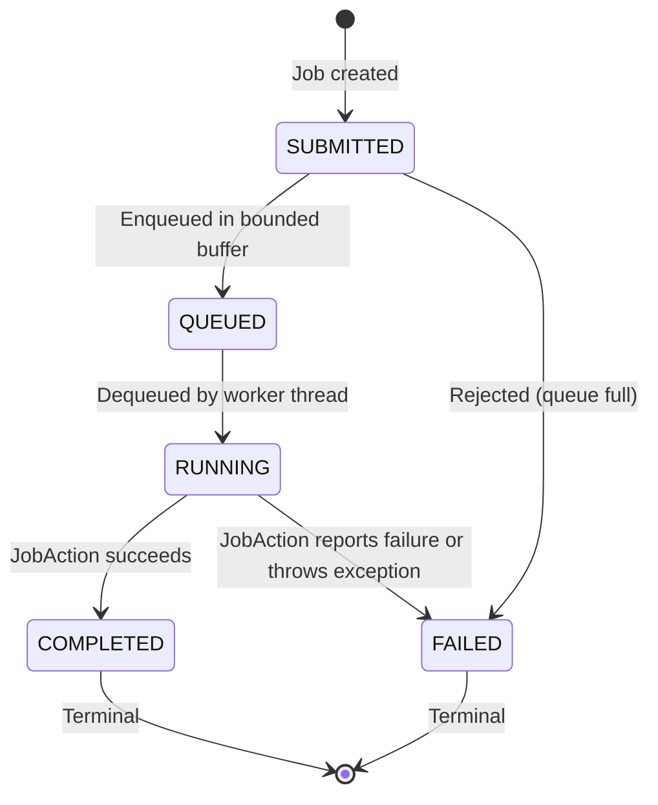

# TaskForge Architecture Document — Milestone 1

## 1. System Overview

TaskForge is an educational single-process job execution engine written in modern Java (LTS 21+), designed to teach core systems engineering and concurrency fundamentals using only the standard Java Class Library (no third-party dependencies).

Milestone 1 establishes the deterministic foundational core:
- A thread-safe **Bounded FIFO Job Queue** providing backpressure.
- A configurable **Worker Pool** managing dedicated worker threads.
- An explicit **Job Lifecycle State Machine** with monotonically non-decreasing timestamps.
- **Deterministic Simulated Workloads** demonstrating success, controlled failure, and fault isolation.
- Real-time **Execution Event Logging** for observability.

---

## 2. Architecture & Component Diagram

```mermaid
flowchart TD
    subgraph ClientLayer["Producer Layer"]
        CLI["CLI Demo / Producer Threads"]
    end

    subgraph EngineLayer["TaskForgeEngine"]
        Registry[("In-Memory Job Registry\n(ConcurrentHashMap)")]
        Journal["JobEventJournal\n(CopyOnWriteArrayList)"]
        
        subgraph QueueLayer["Bounded FIFO Buffer"]
            Queue["BoundedJobQueue\n(Circular Array Buffer)\n• ReentrantLock\n• Condition: notFull\n• Condition: notEmpty"]
        end
        
        subgraph WorkerLayer["WorkerPool"]
            W0["taskforge-worker-0"]
            W1["taskforge-worker-1"]
            W2["taskforge-worker-2"]
        end
    end

    CLI -->|submit()| EngineLayer
    EngineLayer -->|1. register| Registry
    EngineLayer -->|2. publish SUBMITTED| Journal
    EngineLayer -->|3. offer() / put()| Queue
    
    Queue -->|poll() / take()| W0
    Queue -->|poll() / take()| W1
    Queue -->|poll() / take()| W2
    
    W0 -->|execute JobAction| Registry
    W1 -->|execute JobAction| Registry
    W2 -->|execute JobAction| Registry

    W0 -->|publish EVENTS| Journal
    W1 -->|publish EVENTS| Journal
    W2 -->|publish EVENTS| Journal
    
    Journal -.->|stream live| CLI
```

---

## 3. Component Breakdown

### 3.1 Job Model (`com.taskforge.model.Job`)
Every unit of work is represented by a `Job` instance:
- **Identity**: Unique string `id` and descriptive `name`.
- **Workload**: Functional interface `JobAction` receiving a `JobExecutionContext`.
- **State**: `JobStatus` (`SUBMITTED`, `QUEUED`, `RUNNING`, `COMPLETED`, `FAILED`).
- **Telemetry**: `attemptCount`, `createdAt`, `enqueuedAt`, `startedAt`, `completedAt`, `assignedWorker`, and `JobResult`.

#### State Machine Invariants:


- Any attempt to perform an illegal state transition (e.g. from `SUBMITTED` directly to `RUNNING`, or any transition away from a terminal state) throws an `IllegalStateException`.
- State transitions are synchronized on the `Job` instance to guarantee thread safety.

### 3.2 Bounded FIFO Queue (`com.taskforge.queue.BoundedJobQueue`)
Implemented as a circular array buffer from first principles using standard concurrency primitives:
- **`ReentrantLock`**: Protects head, tail, count, and array access. A fair lock policy is used to prevent thread starvation under continuous contention.
- **`Condition notFull`**: Worker/producer backpressure. Producers calling `put()` wait on this condition when `count == capacity`.
- **`Condition notEmpty`**: Consumer coordination. Worker threads wait on this condition when `count == 0`.
- **Circular Wraparound**: Index arithmetic `(index + 1) % capacity` avoids memory copying or element shifting during enqueue/dequeue.

### 3.3 Worker Pool (`com.taskforge.engine.WorkerPool`)
- Spawns a configurable number of dedicated, non-daemon threads named `taskforge-worker-0`, `taskforge-worker-1`, etc.
- Loop mechanism:
  - Workers use timed polling (`poll(100ms)`) to prevent blocking indefinitely, allowing them to detect engine shutdown signals promptly.
  - Workers run while `running == true` OR while `!queue.isEmpty()`, ensuring that already-queued jobs are fully drained during a graceful shutdown.
- **Fault Boundary**: If a job's `JobAction` throws an unchecked exception (such as `NullPointerException` or `IllegalArgumentException`), the worker thread catches `Throwable`, transitions the job to `FAILED`, records the event, and continues servicing subsequent jobs without worker crash.

### 3.4 Event Journaling (`com.taskforge.event.JobEventJournal`)
- Records structured, immutable `JobEvent` records with microsecond timestamps and thread identifiers.
- Uses `CopyOnWriteArrayList` to provide lock-free read iteration while allowing concurrent writes.
- Dispatches events to synchronous callbacks (such as console formatters) without modifying job execution flow.

---

## 4. Thread-Safety Assumptions & Concurrency Guarantees

1. **Mutual Exclusion on the Queue**:
   All state-mutating operations on `BoundedJobQueue` (`put`, `offer`, `take`, `poll`) acquire the queue's `ReentrantLock`. No two threads can mutate queue indices or internal buffer slots concurrently.

2. **Spurious Wakeup Protection**:
   All condition waits (`await()`, `awaitNanos()`) are enclosed in `while` loop predicates (`while (count == capacity)` and `while (count == 0)`), as mandated by the Java Memory Model to guard against spurious wakeups.

3. **Memory Visibility & Happens-Before**:
   - Releasing a `ReentrantLock` happens-before acquiring that same lock. This guarantees that changes made to the circular buffer by a producer are visible to the worker thread that subsequently acquires the lock and dequeues the item.
   - Starting a worker thread (`Thread.start()`) happens-before any action in that thread.
   - Synchronized methods on `Job` establish a happens-before order on state transitions and timestamp writes.

4. **Engine Shutdown Coordination**:
   `AtomicBoolean` flags (`running`, `shutdownInitiated`) guarantee thread-safe visibility across main and worker threads without heavyweight locking.

---

## 5. Known Limitations (Milestone 1 Scope)

As specified in the milestone requirements, the following features are deliberately excluded from Milestone 1 and deferred to future milestones:

1. **In-Memory Volatility (No Persistence)**:
   All jobs, queues, and event journals exist purely in JVM memory. If the process terminates, all uncompleted jobs and historical logs are lost.
2. **Crash Recovery**:
   There is no write-ahead log (WAL) or checkpointing. A sudden `SIGKILL` or power failure leaves in-flight jobs unrecovered.
3. **Single Process**:
   Execution is restricted to a single JVM; there is no cluster coordination, distributed worker discovery, or remote job submission.
4. **No Automated Retries**:
   Failed jobs transition directly to `FAILED`. Milestone 1 records the attempt count (1), laying the foundation for retry policies in Milestone 2.
5. **No Per-Job Execution Timeouts**:
   If a user-supplied `JobAction` enters an infinite loop or blocks indefinitely, the assigned worker thread will remain occupied until the JVM terminates.
6. **Unbounded Event Log Growth**:
   The in-memory `JobEventJournal` stores events indefinitely for the lifetime of the process. In a long-running system, this would cause memory exhaustion without rotation or retention policies.

---

## 6. Incremental Extensibility Path

Milestone 1 is intentionally structured to facilitate upcoming milestones without architectural rewrites:

| Future Feature | Milestone 1 Extension Point |
|---|---|
| **Configurable Retries** | When a job fails in `WorkerPool`, if `job.getAttemptCount() < maxRetries`, re-enqueue into `BoundedJobQueue` rather than transitioning to `FAILED`. |
| **Priority Scheduling** | Replace or extend the circular buffer in `BoundedJobQueue` with a bounded heap/array ordered by job priority. |
| **Execution Timeouts** | Execute `JobAction` via a watchdog or `CompletableFuture.orTimeout` mechanism. |
| **Disk Persistence / WAL** | Implement a `JobStore` interface behind `TaskForgeEngine.submit()` to append events to disk before queue insertion. |
