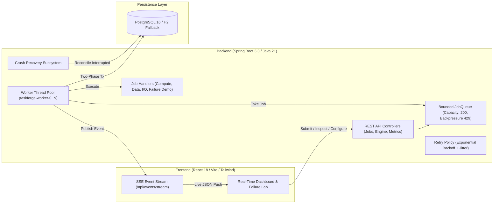

# TaskForge: Concurrent Job Execution & Recovery Platform

[](https://www.oracle.com/java/)
[](https://spring.io/projects/spring-boot)
[](https://react.dev/)
[](https://www.typescriptlang.org/)
[](https://www.postgresql.org/)
[](LICENSE)

**TaskForge** is an observable, concurrent background job execution and recovery platform. Built with **Java 21**, **Spring Boot 3.3**, **PostgreSQL**, and **React 18 / TypeScript**, it demonstrates how modern backend systems process asynchronous work using worker pools, bounded queues, backpressure, exponential retry backoff, transaction boundaries, and crash recovery.

---

## Architecture Overview



---

## Key Features

1. **True Multithreaded Concurrency:**
   - Dedicated OS worker threads named `taskforge-worker-0..N`.
   - Real-time worker state tracking (`IDLE`, `BUSY`, current job ID, active duration).
   - Dynamic worker pool resizing at runtime without dropping running jobs.

2. **Bounded Queue & Backpressure:**
   - In-memory bounded queue with configurable capacity.
   - Rejects excess submissions with HTTP **429 Too Many Requests** when full, safeguarding system health.

3. **Strict Two-Phase Transaction Decoupling:**
   - Short transaction 1: Claim job (`RUNNING`), commit immediately.
   - Long-running execution: Handlers execute completely **outside** database transactions, preventing database connection starvation.
   - Short transaction 2: Finalize outcome (`SUCCEEDED`, `RETRY_WAIT`, or `FAILED`).

4. **Resilient Retry Policies:**
   - Configurable exponential backoff with randomized jitter to prevent the "thundering herd" problem.
   - Deterministic failure scenarios for repeatable verification.

5. **Startup Crash Recovery:**
   - On JVM reboot, the recovery hook scans the database for jobs left in `RUNNING` status from prior crashes, marks the interrupted attempt as failed, and reschedules them for retry.

6. **Real-Time Telemetry via Server-Sent Events (SSE):**
   - Zero-polling browser updates with a 15-second heartbeat ping and automatic disconnect cleanup.

7. **Interactive Developer Web UI:**
   - **Dashboard:** Throughput metrics, live Recharts graph, recent event log.
   - **Live Workers:** Real-time visualization of each worker thread with live ticking timers.
   - **Job Explorer:** Search, filtering by status/type, pagination, manual cancellation, retry, cancel-all pending, and terminal purge.
   - **Job Details Drawer:** Visual timeline of all execution attempts and lifecycle audit log.
   - **Failure Lab:** One-click deterministic fault injection (transient flap, permanent crash, backpressure flood).
   - **Benchmark View:** Comparative throughput benchmarking for 2 vs 4 vs 8 worker threads.

8. **Delayed Execution & Scheduling:**
   - Jobs can specify a delay in seconds (`delaySeconds`), holding them in `RETRY_WAIT` until the target timestamp before automated transition to `QUEUED`.

9. **Cluster Maintenance & Bulk Operations:**
   - One-click bulk cancellation of pending queues (`POST /api/v1/jobs/bulk/cancel`).
   - One-click bulk database purge of terminal jobs (`DELETE /api/v1/jobs/bulk/terminal`) with database-level cascading deletion across attempts and events.

---

## Quick Start

### Option 1: Docker Compose (Recommended for Full Stack)

Run the entire platform (PostgreSQL 16 + Spring Boot Backend + React/Nginx Frontend) with one command:

```powershell
docker compose up --build
```

- **Frontend Dashboard:** [http://localhost:3000](http://localhost:3000)
- **Backend REST API:** [http://localhost:8080](http://localhost:8080)
- **Swagger / OpenAPI Documentation:** [http://localhost:8080/swagger-ui.html](http://localhost:8080/swagger-ui.html)
- **Database:** PostgreSQL on `localhost:5432` (`taskforge` / `taskforge_pass`)

To stop:
```powershell
docker compose down -v
```

---

### Option 2: Local Development Mode (Zero Docker Prerequisites)

The backend includes a zero-configuration embedded H2 persistent database running in PostgreSQL compatibility mode (`application.yml`), allowing instant startup without running a local PostgreSQL instance.

#### 1. Start the Backend
```powershell
cd backend
mvn spring-boot:run
```
The backend starts on `http://localhost:8080`.

#### 2. Start the Frontend Dev Server
In a separate terminal:
```powershell
cd frontend
npm install
npm run dev
```
Open your browser at **[http://localhost:5173](http://localhost:5173)**.

---

## Interactive Demonstration Walkthrough

1. **Submit a Batch of 100 Jobs:**
   - Click the **"Submit Batch (100 Jobs)"** button in the top navigation.
   - Choose a distribution (e.g. 80% Compute, 20% Data Processing) and submit.
   - Observe the jobs immediately enter the `QUEUED` state.

2. **Watch Real-Time Worker Pool Concurrency:**
   - Navigate to the **"Live Workers"** tab.
   - Watch `taskforge-worker-0` through `taskforge-worker-3` claim jobs, transition to `BUSY`, execute computations, and return to `IDLE`.
   - Use the slider to increase worker count to 8 and watch throughput double.

3. **Inject Controlled Failures (Failure Lab):**
   - Navigate to the **"Failure Lab"** tab.
   - Click **"Trigger Transient Network Flap (3 Retries)"**.
   - Notice the job fail, transition to `RETRY_WAIT`, calculate exponential backoff delay, wait, and retry until it succeeds.

4. **Observe Backpressure Protection:**
   - In the **Failure Lab**, click **"Trigger Queue Backpressure (Capacity Flood)"**.
   - Observe the system accept jobs up to queue capacity (200), and reject surplus submissions with HTTP **429 Too Many Requests**.

5. **Test Startup Crash Recovery:**
   - Submit a batch of 20 slow jobs.
   - Stop the backend process (`Ctrl+C`).
   - Restart the backend (`mvn spring-boot:run`).
   - Check the console logs: `reconcileInterruptedJobs()` detects the interrupted jobs and safely reschedules them.

---

## Automated Test Verification

### Backend Tests (JUnit 5 + Mockito + AssertJ)
```powershell
cd backend
mvn clean test
```
*Executes 32 tests across 7 test suites covering concurrency, bounded queues, state transitions, retry policies, delayed scheduling, bulk maintenance, and REST APIs.*

### Frontend Tests (Vitest + React Testing Library)
```powershell
cd frontend
npm run test
```
*Executes 10 unit and component tests verifying UI rendering, command palette, metrics cards, and status badges.*

### Production Build Verification
```powershell
cd frontend
npm run build
```
*Type-checks TypeScript and compiles production distribution bundle.*

---

## Detailed Documentation Suite

For comprehensive technical deep-dives, consult the `docs/` directory:

| Document | Topic |
|---|---|
| [VIVA_DEFENSE_GUIDE.md](VIVA_DEFENSE_GUIDE.md) | Capstone viva defense guide, top 10 examiner questions & answers |
| [docs/ARCHITECTURE.md](docs/ARCHITECTURE.md) | Component architecture, two-phase transaction boundaries, SSE pipeline |
| [docs/STATE_MACHINE.md](docs/STATE_MACHINE.md) | Job lifecycle states, permitted transitions, and terminal guarantees |
| [docs/CONCURRENCY.md](docs/CONCURRENCY.md) | Thread safety, bounded blocking queues, worker loops, and locks |
| [docs/RECOVERY.md](docs/RECOVERY.md) | Crash reconciliation, startup recovery hooks, and interrupted jobs |
| [docs/API.md](docs/API.md) | REST endpoints, request/response JSON schemas, and SSE payload formats |
| [docs/TESTING.md](docs/TESTING.md) | Test strategy, test suites breakdown, and assertion invariants |
| [docs/LEARNING_GUIDE.md](docs/LEARNING_GUIDE.md) | Step-by-step learning guide for Java systems engineering beginners |
| [docs/KNOWN_LIMITATIONS.md](docs/KNOWN_LIMITATIONS.md) | Architectural boundaries, at-least-once delivery, and trade-offs |
| [CONTRIBUTING.md](CONTRIBUTING.md) | Contribution workflow, standards, and pull request guidelines |
| [SECURITY.md](SECURITY.md) | Vulnerability disclosure policy |

---

## Contributing

Contributions, issues, and feature requests are welcome! Please check the [Contributing Guidelines](CONTRIBUTING.md) and review open issues.

---

## License

This project is licensed under the MIT License — see the [LICENSE](LICENSE) file for details.
