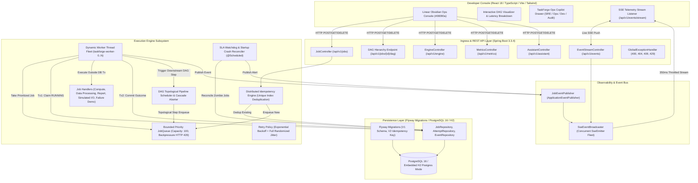

# TaskForge Enterprise — Distributed Workflow Orchestration & Resilience Engine

[](https://www.oracle.com/java/)
[](https://spring.io/projects/spring-boot)
[](https://react.dev/)
[](https://www.typescriptlang.org/)
[](https://vitejs.dev/)
[](https://tailwindcss.com/)
[](https://flywaydb.org/)
[](https://www.postgresql.org/)
[](backend/src/test/)
[](LICENSE)

**TaskForge Enterprise** is an observable, resilient, distributed workflow orchestration platform built for high-throughput asynchronous execution, fault tolerance, and mission-critical task pipelines. Designed with the architecture and aesthetic standards of **Temporal Cloud, Datadog Workflow Automation, and Linear**, it demonstrates first-principles distributed systems engineering: custom worker fleets, bounded queue backpressure, strict two-phase database transaction decoupling, distributed idempotency deduplication, sequential DAG workflow hierarchies, SLA watchdog recovery, and real-time SSE telemetry.

---

## Architecture Overview



---

## Core Enterprise Engineering Capabilities

### 1. True Multi-Threaded Execution Engine & Dynamic Worker Fleet
- Dedicated OS-level worker threads named `taskforge-worker-0..N` running inside a managed pool.
- Real-time thread state inspection (`IDLE`, `BUSY`, current Job ID, active attempt, elapsed execution milliseconds).
- Live pool auto-scaling (1 to 16 threads) and Eco-Mode tuning at runtime without losing active workloads.

### 2. Bounded Ingress Queue & Explicit HTTP 429 Backpressure
- In-memory thread-safe `PriorityBlockingQueue` with configurable bounded capacity (default: 100).
- Safeguards downstream infrastructure against traffic surges: when the bounded queue is saturated, incoming tasks are immediately rejected with **HTTP 429 Too Many Requests**, preventing Out-Of-Memory (OOM) crashes.

### 3. Strict Two-Phase Transaction Decoupling (ACID-Compliant)
- **Phase 1 (Ingress / Claim):** Microsecond database transaction claims the job (`RUNNING`), increments attempt count, commits, and frees the database connection pool immediately.
- **Execution Phase:** Heavy task workloads (CPU bound, remote I/O, report generation) execute completely **outside** database transactions.
- **Phase 2 (Finalization):** Microsecond database transaction commits the final outcome (`SUCCEEDED`, `RETRY_WAIT`, or `FAILED`). This prevents connection starvation under heavy concurrent workloads.

### 4. Distributed Idempotency & Deduplication Engine
- **Flyway Migration `V2__add_idempotency_key.sql`:** Enforces an absolute unique index `idx_jobs_idempotency_key` on `jobs(idempotency_key)`.
- **Atomic Deduplication:** Inbound submissions supplying a duplicate `idempotencyKey` return the existing task immediately without repeating side effects, logging a `JOB_DEDUPLICATED` event.

### 5. Sequential DAG Pipelines & Cascading Aborts
- Supports sequential multi-step workflow chains (`dependsOnJobId`, `pipelineStep`).
- **Post-Commit Queueing:** Child steps are only enqueued after the parent task's `SUCCEEDED` status has been fully committed to the database.
- **Cascading Failure Abort:** If an upstream prerequisite fails permanently or is cancelled by an operator, all downstream dependent tasks are automatically aborted, preventing orphaned tasks from lingering in `QUEUED`.

### 6. Interactive DAG Hierarchy Visualizer (`GET /api/v1/jobs/{id}/dag`)
- The developer console dynamically queries and renders the complete workflow pipeline:
  $$\text{Prerequisite Upstream Node} \longrightarrow \mathbf{\text{Current Active Node}} \longrightarrow \text{Downstream Dependent Node(s)}$$
- Features interactive clickable node cards, status badges, stage numbering (`Step #N`), and truncated UUID identifiers.

### 7. Dual-Segment Latency Trace Bar & Diagnostic JSON Export
- Temporal/Datadog-grade execution timeline breakdown in the task drawer:
  - **Queue Ingress Latency (ms):** Amber segment indicating time spent waiting in the queue buffer before worker assignment.
  - **Worker Execution Duration (ms):** Emerald segment indicating raw execution duration.
  - **Total Latency (ms):** Cumulative turnaround time with percentage breakdown.
- **One-Click Diagnostic Trace:** Downloads a complete postmortem JSON bundle (`trace-{name}-{id}.json`) containing job metadata, DAG dependencies, execution attempts, and the lifecycle audit trail.

### 8. Exponential Backoff with Randomized Jitter
- Retries calculate delays using full randomized jitter:
  $$\text{Delay} = \operatorname{random}(0, \, \text{baseBackoff} \times 2^{\text{attempt} - 1})$$
- Breaks synchronization across failing tasks to avoid the "thundering herd" problem on downstream services.

### 9. Startup Crash Reconciliation & SLA Watchdog
- On JVM boot or worker node failure, the crash reconciliation hook scans the database for tasks stranded in `RUNNING` state, marks the interrupted attempt as failed, and safely reschedules them.
- A background `@Scheduled` watchdog detects zombie tasks exceeding maximum SLA execution thresholds.

### 10. Embedded Offline Ops Copilot (Zero External LLM APIs)
- 100% self-contained, offline intelligence engine operating directly against live database state and queue metrics.
- Four authentic operational modes:
  - **🛡️ SRE & Incident Triage (`SRE`):** Root cause analysis, DLQ failure triage, crash recovery diagnostics.
  - **⚡ Cluster Operations (`OPERATOR`):** Fleet scaling, backpressure tuning, bulk maintenance triggers.
  - **💻 API & SDK Integration (`DEVELOPER`):** `curl`, Python, TypeScript snippets, and JSON schemas.
  - **📋 Audit & Compliance (`AUDITOR`):** Transaction boundaries, SLA latency percentiles, and optimistic locking proofs.

### 11. "Linear Obsidian" Technical Design System
- Modern dark engineering console styled after Linear, Vercel Geist, and Temporal:
  - Slate canvas (`#08090a`), panel surfaces (`#0f1012`), elevated cards (`#141518`), hairline borders (`border-white/[0.08]`).
  - Restrained indigo interactive accents (`#4f46e5` / `#6366f1`).
  - Client-side event throttling (350ms window) ensures a responsive 60 FPS UI even during 100-job bursts.
  - Global Command Palette (`Ctrl+K` / `Cmd+K`) for instant cluster navigation and action execution.

---

## Project Structure

```
TaskForge/
├── backend/                             # Java 21 LTS / Spring Boot 3.3.4 Subsystem
│   ├── src/main/java/com/taskforge/
│   │   ├── config/                      # Async, OpenAPI Swagger, WebMvc CORS
│   │   ├── controller/                  # REST Controllers (Jobs, Engine, Metrics, Assistant, SSE)
│   │   ├── domain/                      # JPA Entities (Job, JobAttempt, JobEvent)
│   │   ├── dto/                         # Request / Response Records (JobDagResponse, etc.)
│   │   ├── engine/                      # ExecutionEngine, JobQueue, WorkerContext, SlaWatchdog
│   │   ├── handler/                     # Job Handlers (Compute, Data, I/O, FailureDemo)
│   │   ├── repository/                  # Spring Data JPA Repositories
│   │   └── service/                     # JobService, AssistantService, MetricsService
│   ├── src/main/resources/
│   │   ├── db/migration/                # Flyway Migrations (V1__init_schema.sql, V2__add_idempotency_key.sql)
│   │   └── application.yml              # Profiles (local H2 Postgres mode, prod PostgreSQL 16)
│   └── pom.xml                          # Maven build specification
├── frontend/                            # React 18 / TypeScript 5 / Vite 5 Subsystem
│   ├── src/
│   │   ├── api/                         # REST & SSE Client
│   │   ├── components/
│   │   │   ├── assistant/               # TaskForge Ops Copilot Drawer
│   │   │   ├── dashboard/               # Metrics Cards, Workers Overview, Chart Views
│   │   │   ├── jobs/                    # Job Table, Create Job Modal, Job Details Drawer, DAG Graph
│   │   │   ├── laboratory/              # Chaos & SLA Resilience Lab (5 Fault Scenarios)
│   │   │   └── layout/                  # Ops TopBar, Navigation Sidebar, Command Palette Modal
│   │   ├── types/                       # TypeScript Domain Definitions
│   │   └── App.tsx                      # Root Application & Telemetry Throttler
│   ├── package.json
│   ├── tsconfig.json
│   └── vite.config.ts
├── docs/                                # Technical Architecture Specifications
│   ├── ARCHITECTURE.md                  # Component Deep-Dive & Transaction Decoupling
│   ├── API.md                           # Comprehensive REST API Specification
│   ├── CONCURRENCY.md                   # Thread Safety & Worker Loop Invariants
│   └── STATE_MACHINE.md                 # State Transitions & Terminal Guarantees
├── docker-compose.yml                   # Production Multi-Container Orchestration
├── Dockerfile                           # Backend Multi-Stage Container Build
├── MANUAL_TESTING_GUIDE.md              # Operational Verification & Testing Runbook
└── README.md                            # Primary Documentation
```

---

## Quick Start Guide

### Option 1: Local Development Mode (Zero Docker Prerequisites)

The platform includes an embedded persistent H2 database pre-configured in PostgreSQL compatibility mode with Flyway schema migrations.

#### 1. Start Backend Server
```powershell
# In a terminal:
cd backend
mvn spring-boot:run
```
*The backend API initializes on `http://localhost:8080`.*  
*Swagger UI is available at `http://localhost:8080/swagger-ui.html`.*

#### 2. Start Frontend Dev Console
```powershell
# In a second terminal:
cd frontend
npm install
npm run dev
```
*Open your browser at **[http://localhost:5173](http://localhost:5173)**.*

---

### Option 2: Production Docker Compose

Run the entire platform (PostgreSQL 16 + Spring Boot Backend + React Frontend) with one command:

```powershell
docker compose up --build
```

- **Frontend Console:** [http://localhost:3000](http://localhost:3000)
- **Backend REST API:** [http://localhost:8080](http://localhost:8080)
- **Swagger Documentation:** [http://localhost:8080/swagger-ui.html](http://localhost:8080/swagger-ui.html)
- **PostgreSQL Database:** `localhost:5432` (`taskforge` / `taskforge_pass`)

---

## Automated Verification & Test Suite

The system has **61 automated tests (100% green)** verifying concurrency, state transitions, fault injection, and frontend UI behavior.

### Backend Test Suite (JUnit 5, Mockito, AssertJ, Spring Boot Test)
```powershell
cd backend
mvn clean test
```
*Executes **47 integration and concurrency tests** across 9 test suites:*
- `JobControllerIntegrationTest`: 14/14 passed (CRUD, batching, idempotency deduplication, DAG hierarchy, filtering)
- `AssistantControllerIntegrationTest`: 4/4 passed (Enterprise personas, suggested prompts, action pills)
- `DagPipelineIntegrationTest`: 4/4 passed (Multi-step DAG pipelines, cascading aborts, cooperative cancellation)
- `ExecutionEngineConcurrencyTest`: 1/1 passed (Multi-worker thread pool concurrency stress testing)
- `JobQueueTest`: 6/6 passed (Bounded queue capacity, priority ordering, HTTP 429 backpressure)
- `RetryPolicyTest`: 2/2 passed (Exponential backoff formula, full jitter distribution)
- `WorkflowAndWatchdogTest`: 6/6 passed (SLA watchdog timeout detection, orphan job recovery)
- `JobHandlerTest`: 4/4 passed (Compute, I/O latency, report generation, deterministic failure lab)
- `MetricsControllerIntegrationTest`: 6/6 passed (Actuator metrics, throughput calculation, telemetry snapshots)

### Frontend Test Suite (Vitest + React Testing Library)
```powershell
cd frontend
npm test -- --run
```
*Executes **14 component and integration tests**:*
- `JobStatusBadge.test.tsx`: 6/6 passed
- `MetricsCards.test.tsx`: 2/2 passed
- `CommandPaletteModal.test.tsx`: 2/2 passed
- `ChatbotDrawer.test.tsx`: 4/4 passed

### Production TypeScript Build
```powershell
cd frontend
npm run build
```
*Type-checks all TypeScript interfaces and compiles an optimized production bundle.*

---

## REST API Reference

| HTTP Method | Endpoint | Description | Status Code |
| :--- | :--- | :--- | :---: |
| `POST` | `/api/v1/jobs` | Submit a single task (supports optional `idempotencyKey` and `delaySeconds`) | `201 Created` / `200 OK` (deduplicated) |
| `POST` | `/api/v1/jobs/batch` | Ingest a batch workload (supports `failureRate`, `isSequential` DAG pipeline) | `202 Accepted` |
| `GET` | `/api/v1/jobs` | List tasks with pagination, search, status filtering, and sorting | `200 OK` |
| `GET` | `/api/v1/jobs/{id}` | Retrieve task details, timing metrics, and worker node assignment | `200 OK` |
| `GET` | `/api/v1/jobs/{id}/dag` | Fetch DAG hierarchy (parent task, current task, downstream dependent tasks) | `200 OK` |
| `GET` | `/api/v1/jobs/{id}/attempts` | List execution attempt history with stack traces and duration | `200 OK` |
| `GET` | `/api/v1/jobs/{id}/events` | Retrieve chronological lifecycle event audit trail | `200 OK` |
| `POST` | `/api/v1/jobs/{id}/retry` | Manually retry a failed or cancelled task | `200 OK` |
| `POST` | `/api/v1/jobs/{id}/cancel` | Cancel a queued task or interrupt a running worker thread | `200 OK` |
| `POST` | `/api/v1/jobs/bulk/cancel` | Cancel all currently pending queued tasks in bulk | `200 OK` |
| `DELETE` | `/api/v1/jobs/bulk/terminal` | Bulk purge finished tasks (`SUCCEEDED`, `FAILED`, `CANCELLED`) | `200 OK` |
| `GET` | `/api/v1/engine/status` | Real-time status of worker threads, queue occupancy, and JVM memory | `200 OK` |
| `POST` | `/api/v1/engine/settings` | Dynamically update worker fleet size and queue capacity | `200 OK` |
| `POST` | `/api/v1/engine/pause` | Pause task ingestion without terminating active running workers | `200 OK` |
| `POST` | `/api/v1/engine/resume` | Resume normal ingestion from paused state | `200 OK` |
| `GET` | `/api/v1/metrics` | System telemetry, throughput per minute, and top failure reasons | `200 OK` |
| `POST` | `/api/v1/assistant/chat` | TaskForge Ops Copilot query (SRE, Operator, Developer, Auditor) | `200 OK` |
| `GET` | `/api/v1/events/stream` | Server-Sent Events (SSE) live push stream for the developer console | `200 OK (text/event-stream)` |

---

## Operational Documentation

Comprehensive architectural and engineering runbooks are maintained in the [`docs/`](docs/) directory:

| Document | Focus Area |
| :--- | :--- |
| [`docs/ARCHITECTURE.md`](docs/ARCHITECTURE.md) | Component architecture, decoupled two-phase transactions, and SSE pipeline |
| [`docs/API.md`](docs/API.md) | Complete OpenAPI / REST specification, request/response schemas, and SSE contracts |
| [`docs/CONCURRENCY.md`](docs/CONCURRENCY.md) | Thread safety guarantees, worker loops, lock-free queues, and CAS semantics |
| [`docs/STATE_MACHINE.md`](docs/STATE_MACHINE.md) | Task lifecycle states, transition matrices, and terminal state invariants |
| [`MANUAL_TESTING_GUIDE.md`](MANUAL_TESTING_GUIDE.md) | End-to-end verification runbook covering fault injection and resilience testing |

---

## Contributing

Contributions, issues, and feature requests are welcome. Please refer to [`CONTRIBUTING.md`](CONTRIBUTING.md) for branch naming conventions, pull request workflows, and code style guidelines.

---

## License

This project is licensed under the MIT License — see the [LICENSE](LICENSE) file for details.
