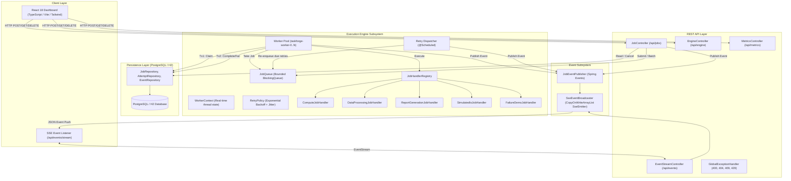
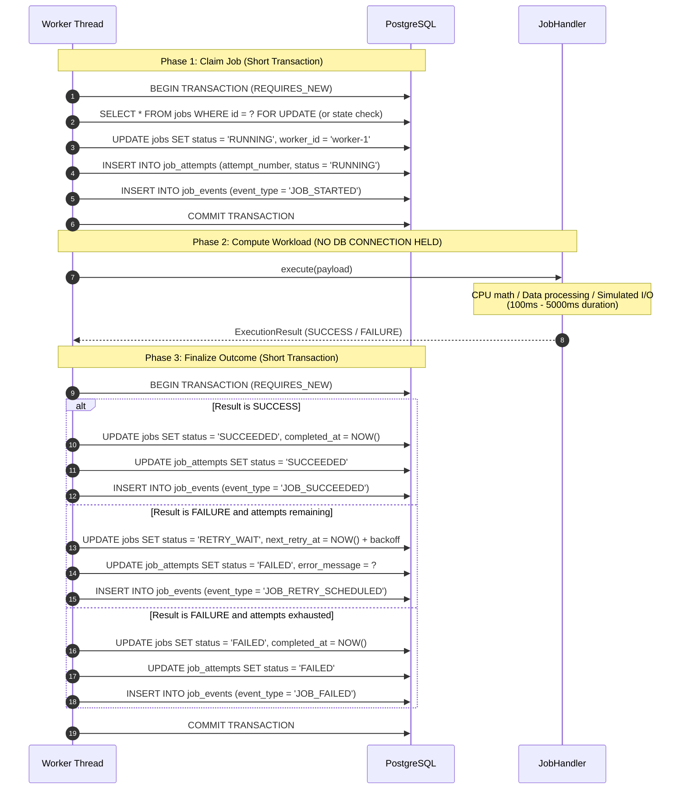

# TaskForge Architecture Guide

## 1. System Overview

TaskForge is an observable, concurrent job execution engine built with Java 21, Spring Boot 3.3, PostgreSQL (with an embedded H2 fallback mode), and a React 18 TypeScript frontend.

The platform is designed to make distributed systems and concurrency patterns (worker pools, queues, transactions, retries, backpressure, and crash recovery) visible and inspectable in real-time.



---

## 2. Layered Responsibilities

TaskForge strictly adheres to clean architectural layering:

| Layer | Responsibility | Components |
|---|---|---|
| **Controllers** | HTTP request parsing, DTO validation, HTTP response status codes. No business logic. | `JobController`, `EngineController`, `MetricsController`, `EventStreamController` |
| **Services / Engine** | State machine validation, concurrency coordination, worker thread lifecycle, retry math. | `ExecutionEngine`, `JobService`, `RetryPolicy`, `WorkerContext` |
| **Domain** | Entities, value objects, lifecycle state machine, optimistic locking versioning. | `Job`, `JobAttempt`, `JobEvent`, `JobStatus`, `JobType` |
| **Repository** | Data access abstraction, custom queries (`findReadyToRetry`, status counts, metrics). | `JobRepository`, `JobAttemptRepository`, `JobEventRepository` |
| **Event Subsystem** | Asynchronous decoupled notifications via Spring `ApplicationEventPublisher`. | `JobEventPublisher`, `SseEventBroadcaster` |
| **Handlers** | Deterministic business workloads (CPU compute, matrix math, data transforms, simulated I/O). | `JobHandlerRegistry`, `JobHandler` implementations |

---

## 3. Transaction Boundaries & The Two-Phase Claim Pattern

A critical anti-pattern in concurrent systems is **holding a database transaction open while performing long-running computations or network I/O**. Doing so exhausts database connection pools (HikariCP), increases lock contention, and leads to system starvation.

TaskForge implements a strict **Decoupled Two-Phase Transaction** model:



### Why this matters:
1. **Connection Pool Health:** A pool with 10 connections can service 50+ concurrent workers without connection starvation, because each transaction takes < 5 milliseconds.
2. **Crash Resilience:** If a worker thread or the JVM crashes during handler execution, the database already records that the job was `RUNNING` with its start time and attempt record. Recovery can safely identify and reconcile it upon restart.

---

## 4. Concurrency & Worker Pool Design

TaskForge does not use indiscriminate `new Thread()` instantiation or raw unbounded cached thread pools. Instead, it manages dedicated worker threads with predictable resource utilization.

### Worker Threads
- Named deterministically: `taskforge-worker-0`, `taskforge-worker-1`, ..., `taskforge-worker-(N-1)`.
- Each worker executes a continuous polling loop:
  ```java
  while (running) {
      if (myWorkerIndex >= activeWorkerCount) {
          // Dynamic scale-down: excess workers sleep until re-enabled
          Thread.sleep(500);
          continue;
      }
      UUID jobId = jobQueue.poll(500, TimeUnit.MILLISECONDS);
      if (jobId != null) {
          processJob(jobId, myWorkerIndex);
      }
  }
  ```
- Uncaught exceptions inside handlers are trapped and recorded as job failures; **they never crash the worker thread itself**.

### Bounded In-Memory Queue & Backpressure
- Backed by `LinkedBlockingQueue<UUID>` with a configurable default capacity (e.g., 200).
- When a client attempts to submit jobs beyond capacity:
  - `JobQueue.offer(jobId)` returns `false`.
  - The service throws `EngineBackpressureException`.
  - The controller returns HTTP 429 (Too Many Requests) with `Retry-After: 5` and a descriptive payload.

---

## 5. Event Publishing & Server-Sent Events (SSE)

Real-time UI telemetry must be non-blocking and low-latency without constant frontend polling.

1. **Spring ApplicationEventPublisher:** When any job transition occurs, the engine emits an internal `JobTransitionEvent`.
2. **SseEventBroadcaster:** Listens to `JobTransitionEvent`, serializes the payload to JSON, and distributes it to all active `SseEmitter` connections.
3. **Dead Connection Cleanup:** Emitted events handle `IOException` or client disconnect by gracefully removing dead emitters from a `CopyOnWriteArrayList`.
4. **Keepalive Heartbeat:** Every 15 seconds, a heartbeat comment (`: ping`) is sent to prevent intermediate HTTP proxies or browser timeouts from closing idle connections.

---

## 6. Monorepo Directory Structure

```
taskforge/
├── .env.example              # Environment variables template
├── docker-compose.yml        # Multi-container orchestration (PostgreSQL + Backend + Frontend)
├── README.md                 # Project root documentation & quickstart
├── docs/                     # Detailed architectural specifications
│   ├── ARCHITECTURE.md       # Layered design, transaction boundaries, diagrams
│   ├── STATE_MACHINE.md      # State transitions, invariants, and guard conditions
│   ├── CONCURRENCY.md        # Concurrency primitives, locks, thread safety
│   ├── RECOVERY.md           # Interruption recovery & crash reconciliation
│   ├── API.md                # REST API endpoints and SSE event schemas
│   ├── TESTING.md            # Test strategy, execution, and coverage
│   ├── LEARNING_GUIDE.md     # Progressive guide for beginners in Java systems
│   └── KNOWN_LIMITATIONS.md  # Explicit non-guarantees and design trade-offs
├── backend/                  # Spring Boot 3.3 / Java 21 Backend
│   ├── Dockerfile            # Multi-stage Maven + Eclipse Temurin 21 JRE
│   ├── pom.xml               # Maven dependencies and build plugins
│   └── src/
│       ├── main/
│       │   ├── java/com/taskforge/
│       │   │   ├── config/      # Spring beans, OpenAPI, CORS, Async config
│       │   │   ├── controller/  # REST controllers & global exception handler
│       │   │   ├── dto/         # Request and Response transfer objects
│       │   │   ├── engine/      # Worker pool, JobQueue, RetryPolicy, Context
│       │   │   ├── event/       # Application events and SSE Broadcaster
│       │   │   ├── handler/     # Deterministic job handlers (Compute, I/O, etc.)
│       │   │   ├── model/       # JPA entities (Job, JobAttempt, JobEvent, Enums)
│       │   │   ├── repository/  # Spring Data JPA repositories
│       │   │   └── service/     # Business logic & transaction boundaries
│       │   └── resources/
│       │       ├── application.yml           # Default local profile (H2 PostgreSQL mode)
│       │       ├── application-postgres.yml  # Docker/prod profile (PostgreSQL 16)
│       │       └── db/migration/             # Flyway DDL schema migrations
│       └── test/java/com/taskforge/          # JUnit 5 integration & concurrency tests
└── frontend/                 # React 18 / TypeScript / Vite / Tailwind Frontend
    ├── Dockerfile            # Multi-stage Node.js build + Nginx static server
    ├── nginx.conf            # Nginx reverse proxy with unbuffered SSE support
    ├── package.json          # npm dependencies (React, Vite, Recharts, Lucide)
    ├── vite.config.ts        # Vite configuration with API reverse proxy
    ├── tailwind.config.js    # Tailwind styling configuration
    └── src/
        ├── api/              # Fetch API client and SSE EventSource listener
        ├── components/       # UI views, modal dialogs, cards, charts, badges
        ├── test/             # Vitest unit and component tests
        └── types/            # TypeScript interfaces matching backend DTOs
```
