# TaskForge Concurrency Architecture

## 1. Concurrency Model Overview

TaskForge implements real Java concurrency using dedicated operating system worker threads, a bounded memory buffer, and non-blocking database transaction boundaries.

```mermaid
sequenceDiagram
    autonumber
    actor Client
    participant Controller as JobController
    participant Service as JobService
    participant Queue as JobQueue (Bounded)
    participant Worker as WorkerThread (Pool)
    participant Engine as ExecutionEngine
    participant DB as PostgreSQL Database
    participant SSE as SseEventBroadcaster

    Client->>Controller: POST /api/v1/jobs/batch (100 jobs)
    Controller->>Service: createBatch(request)
    loop For each job
        Service->>DB: INSERT into jobs (Status: QUEUED)
        Service->>Queue: offer(jobId)
        alt Queue Has Capacity
            Queue-->>Service: true (Enqueued)
        else Queue Full (Backpressure)
            Queue-->>Service: false (Rejected)
            Service->>SSE: Broadcast QUEUE_BACKPRESSURE
        end
    end
    Service-->>Client: 202 Accepted (Submitted & Enqueued counts)

    loop Worker Thread Loop
        Worker->>Queue: poll(200ms)
        Queue-->>Worker: jobId
        Worker->>Engine: claimJob(jobId, workerId)
        rect rgb(30, 41, 59)
            Note over Engine,DB: Short Transaction 1: Claim
            Engine->>DB: SELECT status FROM jobs WHERE id = jobId
            Engine->>DB: UPDATE jobs SET status='RUNNING', worker_id=workerId
            Engine->>DB: INSERT into job_attempts (attempt_number, worker_id)
            Engine->>SSE: Broadcast JOB_STARTED
        end
        Note over Worker: Long-running workload executes OUTSIDE DB transactions
        Worker->>Worker: JobHandler.execute(job, workerId)
        
        rect rgb(30, 41, 59)
            Note over Engine,DB: Short Transaction 2: Completion / Retry
            Worker->>Engine: recordSuccess / recordFailure
            alt Workload Succeeded
                Engine->>DB: UPDATE jobs SET status='SUCCEEDED'
                Engine->>SSE: Broadcast JOB_SUCCEEDED
            else Workload Failed (Attempts Remaining)
                Engine->>DB: UPDATE jobs SET status='RETRY_WAIT', scheduled_at=nextRetry
                Engine->>SSE: Broadcast RETRY_SCHEDULED
            else Workload Failed (Attempts Exhausted)
                Engine->>DB: UPDATE jobs SET status='FAILED'
                Engine->>SSE: Broadcast JOB_FAILED
            end
        end
    end
```

---

## 2. Key Systems Engineering Principles

### 2.1 Bounded Execution Queue & Backpressure
In naive architectures, asynchronous tasks are accepted into unbounded in-memory lists or unbounded thread pools. Under high burst submissions, this results in:
- Out of Memory errors (`java.lang.OutOfMemoryError`).
- Uncontrolled latency spikes.
- Cascading database connection pool exhaustion.

**TaskForge Solution**:
`JobQueue` wraps an `ArrayBlockingQueue<String>` with a hard capacity ceiling (default: 100).
- When a job is submitted, `queue.offer(jobId)` is invoked.
- If capacity is reached, `offer` returns `false`, and an explicit `QueueFullException` (HTTP 429 Too Many Requests) is thrown or marked in the batch summary.
- The database persists the job record, but worker execution is gated until previous jobs finish.

### 2.2 Decoupled Database Transactions
Holding an active database connection and open transaction during slow I/O or CPU operations is a catastrophic bottleneck in systems engineering:
- HikariCP connection pools (typically 10-20 connections) are starved within seconds.
- Database locks remain held, blocking read and write queries.

**TaskForge Solution**:
1. **Transaction 1 (Claim)**: Runs in ~2 milliseconds. Verifies state is `QUEUED`, transitions to `RUNNING`, records the attempt, commits, and releases the DB connection back to the Hikari pool.
2. **Execution Phase**: The worker thread executes the handler (`Compute`, `DataProcessing`, `SimulatedIo`, etc.) for 100ms - 5000ms **with zero open database transactions**.
3. **Transaction 2 (Result)**: Runs in ~2 milliseconds. Re-reads the job, writes the final state (`SUCCEEDED`, `FAILED`, or `RETRY_WAIT`), commits, and releases the connection.

### 2.3 Double Claiming Prevention
If multiple workers concurrently attempt to claim the same job:
- The claim SQL checks `WHERE id = :id AND status = 'QUEUED'`.
- Optimistic locking checks the `@Version` column.
- The first worker to commit succeeds; the second worker reads `status != QUEUED` or encounters an optimistic lock failure and safely skips the job without error.

### 2.4 Jittered Exponential Backoff
When retrying failed tasks, retrying all failed jobs at exact interval multiples causes synchronized retry bursts (the "thundering herd" problem), re-saturating the system.

**TaskForge Formula**:
$$\text{Delay} = \min\left(\text{MaxBackoff}, \text{BaseBackoff} \times 2^{\text{attempt} - 1}\right) \pm \text{Jitter}$$

A randomized jitter of $\pm 10\%$ is injected by `RetryPolicy.java`, smoothing retry distribution across the timeline.
