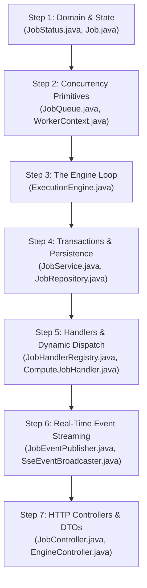

# TaskForge Java & Systems Engineering Learning Guide

Welcome to the TaskForge codebase! This guide is written specifically for developers who want to master Java and backend systems engineering through practical, hands-on exploration of an asynchronous execution engine.

---

## 1. The Core Engineering Problem

Imagine you run an image processing service or a bank transaction system. A user clicks "Generate 1,000 PDF Reports".

- **The Naive Approach:** You handle the request directly in your HTTP servlet thread:
  ```java
  // ANTI-PATTERN: Blocking the HTTP thread
  @PostMapping("/reports")
  public ResponseEntity<String> generateReports() {
      for (int i = 0; i < 1000; i++) {
          renderPdfDocument(i); // Takes 2 seconds each -> 2,000 seconds total!
      }
      return ResponseEntity.ok("Done");
  }
  ```
  *Consequence:* The browser times out after 30 seconds. The server thread is blocked, preventing other users from browsing the site. If the server crashes on report #542, all progress is lost and nobody knows what succeeded.

- **The Systems Engineering Approach (TaskForge):**
  1. The HTTP request accepts the batch, assigns UUIDs, commits them to a persistent database as `QUEUED`, and returns **immediately** with HTTP 202/200 (`{"batchId": "...", "jobCount": 1000}`).
  2. A dedicated pool of background worker threads picks up jobs from a bounded queue.
  3. Work executes asynchronously across multiple CPU cores.
  4. Failures are caught, categorized, and scheduled for retry with exponential backoff.
  5. Live execution events are pushed to the browser over Server-Sent Events (SSE).
  6. If the server is restarted mid-run, an initialization hook checks the database and safely recovers interrupted jobs.

---

## 2. Progressive Learning Path

To understand this codebase incrementally, study the classes in this exact order:



---

## 3. Deep-Dive Concepts

### Concept A: Java Concurrency & Worker Pools

#### Why not create a `new Thread()` for every job?
Spawning an OS thread in Java allocates approximately 1 MB of stack memory and incurs expensive kernel context-switching overhead. If 10,000 jobs arrive at once, creating 10,000 threads will trigger an `OutOfMemoryError: unable to create native thread`.

#### How TaskForge solves this:
In `ExecutionEngine.java`, we maintain a fixed array of pre-allocated worker threads:
```java
// backend/src/main/java/com/taskforge/engine/ExecutionEngine.java
private final Thread[] workerThreads = new Thread[MAX_WORKERS];

for (int i = 0; i < maxWorkers; i++) {
    final int workerIndex = i;
    workerThreads[i] = new Thread(() -> workerLoop(workerIndex), "taskforge-worker-" + workerIndex);
    workerThreads[i].setDaemon(false);
    workerThreads[i].start();
}
```
Each thread executes a loop:
1. Waits on the bounded queue using `jobQueue.poll(500, TimeUnit.MILLISECONDS)`.
2. Claims the job in the database.
3. Executes the business handler.
4. Records the result and returns to step 1.

The thread never dies—it simply waits for more work.

---

### Concept B: Bounded Queues and Backpressure

What happens when jobs arrive faster than workers can process them?

If your in-memory queue is unbounded (e.g. standard `new LinkedList<>()`), memory grows indefinitely until the JVM crashes with `OutOfMemoryError: Java heap space`.

In TaskForge:
```java
// backend/src/main/java/com/taskforge/engine/JobQueue.java
private final BlockingQueue<UUID> queue;

public JobQueue(int capacity) {
    this.queue = new LinkedBlockingQueue<>(capacity); // e.g. 200 slots
}

public boolean offer(UUID jobId) {
    return queue.offer(jobId); // Returns false if queue is full
}
```
When `offer()` returns `false`, `JobService` throws `EngineBackpressureException`, which `GlobalExceptionHandler` converts into HTTP **429 Too Many Requests**:
```json
{
  "timestamp": "2026-10-18T18:00:00Z",
  "status": 429,
  "error": "Too Many Requests",
  "message": "Engine queue is at maximum capacity (200). Please throttle submissions or increase worker concurrency."
}
```
This is **Backpressure**: the backend protects its own health by signaling to callers that it cannot accept more load.

---

### Concept C: The Two-Phase Transaction Anti-Pattern Avoided

One of the most common mistakes in Spring Boot applications is annotating the entire worker execution with `@Transactional`:

```java
// DANGEROUS ANTI-PATTERN:
@Transactional
public void processJob(UUID jobId) {
    Job job = jobRepository.findById(jobId).orElseThrow();
    job.setStatus(JobStatus.RUNNING);
    jobRepository.save(job);

    // DANGER! Database connection remains held while running slow computation!
    runSlowWorkload(job); // 5 seconds of CPU or simulated network I/O

    job.setStatus(JobStatus.SUCCEEDED);
    jobRepository.save(job);
}
```
If you have 10 workers and HikariCP has 10 connections, all 10 connections are locked idle while the CPU crunches math. Any incoming HTTP request that needs to read from the database will stall and fail with `ConnectionTimeoutException`.

#### TaskForge's Clean Decoupling:
1. **Transaction 1 (`claimJob`):** Starts transaction, updates status to `RUNNING`, commits transaction (takes ~2 ms). Connection returned to pool.
2. **Execution Phase (`jobHandler.execute`):** Pure Java code execution. **Zero database connections held.**
3. **Transaction 2 (`completeJob` or `failJob`):** Starts transaction, records final status and attempt history, commits transaction (takes ~2 ms).

---

### Concept D: Exponential Backoff & Jitter

When an external service or database fails, retrying immediately often worsens the outage (the "thundering herd" problem).

In `RetryPolicy.java`, TaskForge implements exponential backoff with configurable jitter:
$$Delay = \min\left(Delay_{\max}, Delay_0 \times Multiplier^{(attempt - 1)}\right) \pm Jitter$$

For example, with initial delay = 2s, multiplier = 2.0:
- Attempt 1: $2 \times 2^0 = 2\text{s}$ ($\pm$ jitter)
- Attempt 2: $2 \times 2^1 = 4\text{s}$ ($\pm$ jitter)
- Attempt 3: $2 \times 2^2 = 8\text{s}$ ($\pm$ jitter)

Jitter breaks synchronization across multiple failing jobs so they do not all retry at the exact same millisecond.

---

### Concept E: Optimistic Locking with `@Version`

How do we ensure that if an admin cancels a job while a worker is trying to complete it, the two updates don't overwrite each other?

In `Job.java`:
```java
@Version
private Long version;
```
When Hibernate generates the SQL update, it automatically attaches a version guard:
```sql
UPDATE jobs 
SET status = 'SUCCEEDED', version = version + 1 
WHERE id = '...' AND version = 3;
```
If another transaction changed the row first (bumping the version to 4), the `WHERE` condition matches 0 rows, and Spring/Hibernate throws `OptimisticLockingFailureException`. The collision is caught and handled safely.

---

## 4. Hands-On Experiments to Try

1. **Watch Concurrency in Real-Time:**
   - Set worker count to 2 in the UI.
   - Submit 50 `COMPUTE` jobs.
   - Go to the **Live Workers** tab and observe `taskforge-worker-0` and `taskforge-worker-1` alternating jobs.
   - Increase workers to 8 dynamically and watch the throughput jump.

2. **Test Exponential Backoff in the Failure Lab:**
   - Go to the **Failure Lab** tab.
   - Click **Trigger Transient Network Flap (3 Retries)**.
   - Open the **Job Explorer**, click the failing job, and watch the attempts timeline: notice how each attempt waits progressively longer before retrying.

3. **Observe Queue Backpressure:**
   - Open the **Failure Lab** and click **Trigger Queue Backpressure (Capacity Flood)**.
   - Watch the backend accept up to queue capacity, then reject surplus submissions with HTTP 429.

4. **Verify Startup Crash Recovery:**
   - Submit 20 long-running jobs.
   - Stop the backend process (`Ctrl+C`).
   - Restart the backend.
   - Check the console logs: observe `reconcileInterruptedJobs()` detect the jobs that were abandoned mid-execution, mark their interrupted attempts as failed, and reschedule them for retry.
