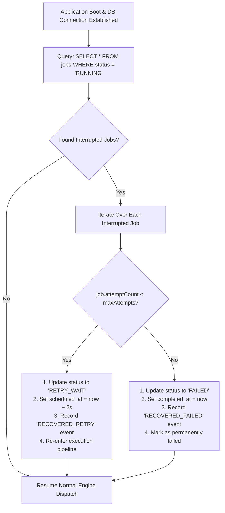

# TaskForge Crash Recovery & Interruption Policy

## 1. The Interruption Problem

In distributed systems and asynchronous job processors, backend processes can terminate abruptly at any moment due to:
- Operating system termination (`SIGKILL`, OOM killer).
- Hardware or power interruption.
- Container eviction or rolling deployment restarts.
- Unhandled JVM fatal errors.

When a process dies while worker threads are actively executing jobs:
1. The in-memory thread pool and queue are instantly obliterated.
2. The database rows for those jobs still reflect `status = 'RUNNING'`.
3. In-flight jobs will remain trapped in the `RUNNING` state indefinitely (orphaned or "zombie" jobs) unless explicit recovery logic is executed upon system startup.

---

## 2. Startup Reconciliation Protocol

TaskForge implements a safe startup recovery routine executed by `ExecutionEngine.recoverInterruptedJobs()` on `@PostConstruct`:

### Recovery Principles:
1. **Never Blindly Re-run Without Recording**:
   TaskForge records an explicit `RECOVERED_RETRY` or `RECOVERED_FAILED` event in the audit trail, logging the worker ID and the fact that a process restart occurred while the job was active.
2. **Respect Maximum Attempts**:
   If a job had already reached its maximum retry attempts, it is transitioned to `FAILED` rather than looped indefinitely.
3. **Grace Period Delay**:
   Re-scheduled recovery jobs are assigned a small delay (2 seconds) to allow database connections, worker threads, and dependent subsystems to stabilize before reprocessing.

---

## 3. Why "Exactly-Once" Execution Is Impossible

> [!WARNING]
> **No Exactly-Once Execution Guarantee**
> Recovering database records is **not** equivalent to guaranteeing that external side effects were executed exactly once.

In systems engineering, guaranteeing "exactly-once" execution across independent failure domains (JVM process vs external service or database) is fundamentally impossible without two-phase commit (2PC) or distributed transactions, both of which introduce severe performance and availability penalties (CAP theorem).

Consider this failure window:
1. A worker thread executes a payment charge or external email API call.
2. The external call succeeds.
3. Before the worker thread can execute `recordSuccess()` in PostgreSQL, power is lost.
4. Upon restart, TaskForge detects `status = 'RUNNING'` and re-attempts the job.
5. The email or charge is sent a second time (**at-least-once execution**).

### Recommended Solution: Idempotency
Because TaskForge guarantees **at-least-once execution** under crash recovery, production workloads must be designed to be **idempotent**:
- Use unique idempotency keys (derived from `job.getId() + "-" + attemptNumber`).
- Ensure downstream database updates use upserts (`INSERT ... ON CONFLICT DO UPDATE`) rather than raw inserts.
- Rely on external APIs that accept client request tokens to discard duplicate calls.
