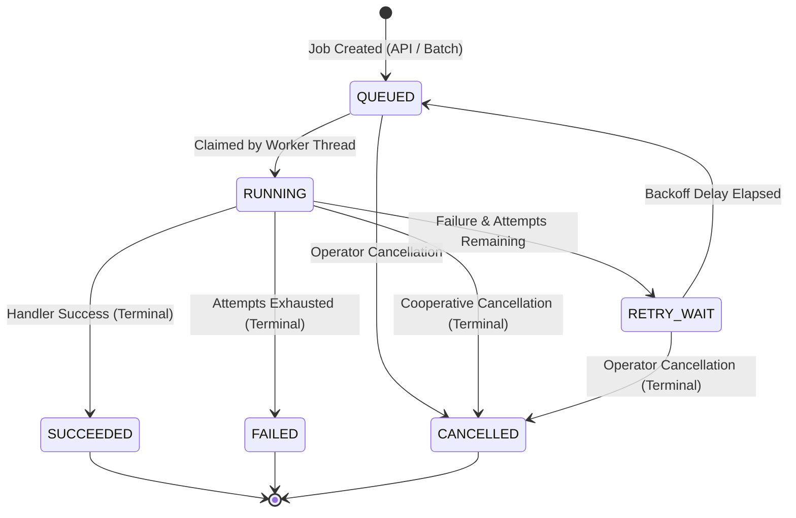

# TaskForge Job Lifecycle State Machine

## 1. State Machine Definition

The TaskForge job execution engine enforces an explicit state machine for every job submitted to the system. State transitions are validated at both the domain model level (`Job.java`) and the persistence layer using optimistic locking (`@Version`).

---

## 2. States & Semantics

| State | Terminal? | Description |
|---|:---:|---|
| `QUEUED` | No | Job has been persisted in PostgreSQL and placed into the bounded in-memory buffer awaiting an available worker thread. |
| `RUNNING` | No | Job has been safely claimed by an OS worker thread. The execution attempt is recorded. |
| `RETRY_WAIT` | No | Job failed a transient execution attempt, but has remaining attempts (`attemptCount < maxAttempts`). Scheduled for future retry. |
| `SUCCEEDED` | **Yes** | Workload completed successfully. Final execution metrics recorded. |
| `FAILED` | **Yes** | Job permanently failed after exhausting maximum attempts or encountering fatal unretryable errors. |
| `CANCELLED` | **Yes** | Job was cancelled by an operator prior to completion. |

---

## 3. Transition Invariant Matrix

| From \ To | `QUEUED` | `RUNNING` | `RETRY_WAIT` | `SUCCEEDED` | `FAILED` | `CANCELLED` |
|---|:---:|:---:|:---:|:---:|:---:|:---:|
| **`QUEUED`** | — | **VALID** | Invalid | Invalid | Invalid | **VALID** |
| **`RUNNING`** | Invalid | — | **VALID** | **VALID** | **VALID** | **VALID** |
| **`RETRY_WAIT`** | **VALID** | Invalid | — | Invalid | Invalid | **VALID** |
| **`SUCCEEDED`** | Invalid | Invalid | Invalid | — | Invalid | Invalid |
| **`FAILED`** | Invalid* | Invalid | Invalid | Invalid | — | Invalid |
| **`CANCELLED`** | Invalid* | Invalid | Invalid | Invalid | Invalid | — |

*\*Note: Manual operator retry from the UI/API resets a `FAILED` or `CANCELLED` job by transitioning it to `QUEUED` via an explicit administrative command, clearing previous error messages.*

---

## 4. Concurrency & Terminal State Protection

1. **Terminal State Immutability**:
   Once a job enters `SUCCEEDED`, `FAILED`, or `CANCELLED`, its state cannot be modified by any background worker thread.
2. **Optimistic Locking Guard**:
   Every database row contains an integer `version` column. If two threads attempt to transition the same job concurrently, Hibernate detects the version mismatch and aborts the conflicting transaction with an `OptimisticLockException`.
3. **Transaction Isolation**:
   Claiming a job executes inside a short, dedicated transaction (`Propagation.REQUIRES_NEW`). Long-running simulated work runs **outside** of any database transaction.
