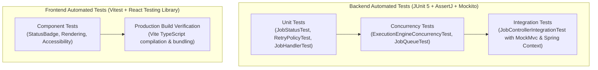

# TaskForge Testing Strategy & Test Verification Guide

## 1. Overview

TaskForge employs a multi-tiered automated testing suite to verify system invariants across concurrency, state transitions, retry dynamics, and HTTP interfaces.

The testing strategy is designed around the core principle: **concurrency bugs must be caught deterministically by automated tests, never left to random chance**.



---

## 2. Backend Test Suites

All backend tests are located under `backend/src/test/java/com/taskforge/`:

### 1. `JobStatusTest.java` (Domain & State Machine Invariants)
- **Purpose:** Verifies that the `JobStatus` state machine enforces allowed and forbidden transitions.
- **Key Assertions:**
  - `QUEUED` can transition to `RUNNING` or `CANCELLED`.
  - `RUNNING` can transition to `SUCCEEDED`, `RETRY_WAIT`, `FAILED`, or `CANCELLED`.
  - `RETRY_WAIT` can transition to `QUEUED` or `CANCELLED`.
  - Terminal states (`SUCCEEDED`, `FAILED`, `CANCELLED`) throw `IllegalStateException` on any attempted transition.
  - Ensures a job cannot be "resurrected" once terminated.

### 2. `JobQueueTest.java` (Bounded Queue & Backpressure)
- **Purpose:** Verifies bounded capacity semantics and thread-safe queue behavior.
- **Key Assertions:**
  - Standard FIFO ordering: elements are dequeued in the exact order enqueued.
  - Non-blocking `offer()` returns `false` when capacity is reached.
  - Blocking `take()` waits until an element is placed onto the queue.
  - Queue `size()` and `remainingCapacity()` accurately reflect queue state.

### 3. `RetryPolicyTest.java` (Backoff Mathematics)
- **Purpose:** Verifies exponential backoff calculations and jitter boundaries.
- **Key Assertions:**
  - Attempt 1 produces expected base delay ($initialDelay \times multiplier^0$).
  - Delay increases exponentially with each subsequent attempt ($initialDelay \times multiplier^{attempt - 1}$).
  - Maximum delay cap ($maxDelaySeconds$) is strictly observed and never exceeded.
  - Jitter stays within the configured $\pm jitterPercent$ boundary without negative durations.

### 4. `JobHandlerTest.java` (Deterministic Job Execution)
- **Purpose:** Verifies each deterministic demonstration handler executes and returns correct metadata.
- **Key Assertions:**
  - `ComputeJobHandler`: Computes prime factorization / Fibonacci series deterministically.
  - `DataProcessingJobHandler`: Processes generated payloads and returns mean, median, standard deviation.
  - `ReportGenerationJobHandler`: Generates structured markdown/JSON summary data.
  - `SimulatedIoJobHandler`: Simulates realistic external latency without touching real networks.
  - `FailureDemoJobHandler`: Fails deterministically for the first $N$ attempts and succeeds on attempt $N+1$, enabling reliable retry testing.

### 5. `ExecutionEngineConcurrencyTest.java` (Multithreaded Stress Test)
- **Purpose:** Proves thread safety, mutual exclusion, and zero race conditions under concurrent worker load.
- **Key Assertions:**
  - Initializes an engine with 8 concurrent worker threads.
  - Submits a burst of 40 concurrent jobs simultaneously.
  - Verifies all 40 jobs reach terminal `SUCCEEDED` status.
  - Asserts that every single job is claimed and processed exactly once.
  - Asserts that no worker thread deadlocks, leaks resources, or throws unhandled exceptions.

### 6. `JobControllerIntegrationTest.java` (REST & Web Layer)
- **Purpose:** End-to-end HTTP integration testing using Spring MockMvc and in-memory database.
- **Key Assertions:**
  - `POST /api/jobs`: Submits a job and receives HTTP 201 with populated UUID and `QUEUED` status.
  - `POST /api/jobs/batch`: Submits 100 jobs in a single request and receives HTTP 200 with all job IDs.
  - `GET /api/jobs/{id}`: Returns persisted job details with attempt history.
  - `POST /api/jobs/{id}/cancel`: Successfully cancels a queued or running job.
  - `POST /api/engine/settings`: Dynamically updates worker thread pool size and retry backoff.
  - Backpressure test: Flooding the queue beyond capacity triggers HTTP 429 (Too Many Requests).

---

## 3. How to Run Backend Tests

Navigate to `taskforge/backend` in your terminal:

```powershell
# Run the entire backend test suite
mvn test

# Run a specific test class (e.g. Concurrency Test)
mvn test -Dtest=ExecutionEngineConcurrencyTest

# Run with detailed debug output
mvn test -Dtest=JobControllerIntegrationTest -Dspring.profiles.active=local
```

### Expected Output Summary:
```text
[INFO] Running com.taskforge.model.JobStatusTest
[INFO] Tests run: 5, Failures: 0, Errors: 0, Skipped: 0
[INFO] Running com.taskforge.engine.JobQueueTest
[INFO] Tests run: 4, Failures: 0, Errors: 0, Skipped: 0
[INFO] Running com.taskforge.engine.RetryPolicyTest
[INFO] Tests run: 3, Failures: 0, Errors: 0, Skipped: 0
[INFO] Running com.taskforge.handler.JobHandlerTest
[INFO] Tests run: 4, Failures: 0, Errors: 0, Skipped: 0
[INFO] Running com.taskforge.engine.ExecutionEngineConcurrencyTest
[INFO] Tests run: 1, Failures: 0, Errors: 0, Skipped: 0
[INFO] Running com.taskforge.controller.JobControllerIntegrationTest
[INFO] Tests run: 3, Failures: 0, Errors: 0, Skipped: 0
[INFO] ------------------------------------------------------------------------
[INFO] BUILD SUCCESS
[INFO] ------------------------------------------------------------------------
[INFO] Total time: 02:10 min
[INFO] Finished at: 2026-10-18T18:06:50+05:30
```

---

## 4. Frontend Test Suites

Frontend tests are located under `frontend/src/test/`:

### 1. `JobStatusBadge.test.tsx` (Component & Visual Regression)
- **Purpose:** Verifies that status badges render accessible text, distinct color palettes, and active pulse animations.
- **Key Assertions:**
  - Renders distinct classes for `QUEUED`, `RUNNING`, `RETRY_WAIT`, `SUCCEEDED`, `FAILED`, and `CANCELLED`.
  - Verifies presence of accessible labels for screen readers.
  - Checks that `RUNNING` status displays an animated spinning spinner icon.

---

## 5. How to Run Frontend Tests

Navigate to `taskforge/frontend` in your terminal:

```powershell
# Run frontend unit tests with Vitest
npm run test

# Run Vitest in UI / watch mode
npm run test -- --ui

# Verify complete TypeScript compilation and production bundle build
npm run build
```

### Expected Output Summary:
```text
 ✓ src/test/JobStatusBadge.test.tsx (6 tests) 142ms
   ✓ JobStatusBadge > renders QUEUED badge with amber theme
   ✓ JobStatusBadge > renders RUNNING badge with blue theme and active spinner
   ✓ JobStatusBadge > renders RETRY_WAIT badge with purple theme
   ✓ JobStatusBadge > renders SUCCEEDED badge with emerald theme
   ✓ JobStatusBadge > renders FAILED badge with rose theme
   ✓ JobStatusBadge > renders CANCELLED badge with slate theme

 Test Files  1 passed (1)
      Tests  6 passed (6)
   Start at  18:13:20
   Duration  1.61s
```
